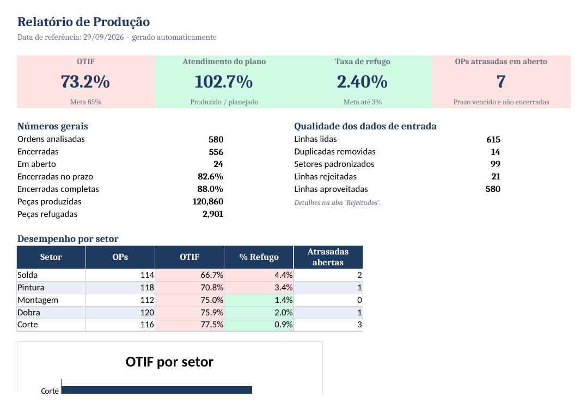

# Relatório Automático de Produção

Sistema em Python que pega a exportação de ordens de produção de um ERP, confere e limpa os dados, calcula os indicadores do PCP e entrega um relatório em Excel pronto, com gráficos e semáforo de metas. Tudo com um único comando.



## Por que eu criei este projeto

Eu trabalho com PCP numa indústria e sei como é o fechamento de relatório de produção: exportar do ERP, colar na planilha, arrumar setor escrito de cinco jeitos diferentes, caçar linha duplicada, conferir data, montar tabela dinâmica, fazer gráfico... e repetir tudo na semana seguinte.

Este projeto mostra como eu automatizaria esse processo do começo ao fim, de um jeito seguro: **o sistema só lê o arquivo exportado e nunca grava nada de volta no ERP**. Se algo der errado, o pior que acontece é o relatório não sair, e o log explica o motivo.

> Todos os dados deste repositório são **fictícios**, gerados por script. Nenhum dado de empresa real é usado.

| | Processo manual | Com o sistema |
|---|---|---|
| Tempo para gerar o relatório | 1 a 2 horas | menos de 1 segundo |
| Linhas com erro na base | passam despercebidas | separadas, com o motivo |
| Resultado | depende de quem faz | sempre o mesmo cálculo |

## O que ele faz

1. **Lê** a exportação do ERP (`.csv` com `;` ou `.xlsx`) e confere se todas as colunas obrigatórias existem.
2. **Limpa e valida** os dados:
   - remove linhas duplicadas;
   - padroniza nomes de setor (`CORTE`, ` corte `, `Soldagem` → `Corte`, `Solda`);
   - converte números com vírgula decimal e datas no formato brasileiro;
   - rejeita linhas com problema (data que não existe, quantidade negativa, setor vazio, OP repetida com dados diferentes...) e **registra o motivo de cada uma**.
3. **Calcula os indicadores**: OTIF, atendimento do plano, taxa de refugo, atraso médio e OPs atrasadas em aberto, no geral, por setor, por máquina e por semana.
4. **Gera o Excel** com seis abas:
   - **Resumo:** cartões de indicadores com semáforo de meta, qualidade dos dados de entrada e gráfico de OTIF por setor.
   - **Por setor:** indicadores por setor e máquina.
   - **Evolução semanal:** tabela e gráfico de linha do OTIF.
   - **Atrasadas:** OPs vencidas e não encerradas, da mais atrasada para a menos atrasada.
   - **Rejeitados:** linhas descartadas e o motivo, para corrigir na origem.
   - **Dados tratados:** a base limpa usada nos cálculos.
5. **Registra um log** de cada execução na pasta `logs/`.

## Como os indicadores são calculados

| Indicador | Regra |
|---|---|
| **No prazo** | OP encerrada com data de conclusão menor ou igual à data prevista |
| **Completa** | quantidade boa (produzida − refugo) maior ou igual à planejada |
| **OTIF** | % das OPs encerradas que foram no prazo **e** completas |
| **Atendimento do plano** | total produzido ÷ total planejado (OPs encerradas) |
| **Taxa de refugo** | refugo ÷ produzido |
| **Atrasada em aberto** | OP não encerrada com data prevista já vencida |

Metas usadas no semáforo: OTIF ≥ 85% e refugo ≤ 3%. Elas ficam no início de `src/relatorio.py`.

## Como rodar

Pré-requisito: Python 3.10 ou mais novo.

```bash
# 1. Clonar e entrar na pasta
git clone https://github.com/Oliver-Norton10/relatorio-producao.git
cd relatorio-producao

# 2. Criar e ativar o ambiente virtual
python -m venv .venv
.venv\Scripts\activate          # Windows
# source .venv/bin/activate     # Linux / macOS

# 3. Instalar as dependências
pip install -r requirements.txt

# 4. Gerar os dados fictícios
python -m src.gerar_dados

# 5. Gerar o relatório
python -m src.main
```

O relatório é salvo em `dados/saida/relatorio_producao_AAAA-MM-DD.xlsx`.

No Windows, também dá para dar dois cliques em **`gerar_relatorio.bat`**.

### Opções

```bash
python -m src.main --entrada caminho/arquivo.xlsx --saida pasta/destino
python -m src.main --data-referencia 2026-09-15     # fechar o relatório numa data específica
python -m src.gerar_dados --ordens 5000 --semente 7  # base maior e diferente
```

## Testes

```bash
python -m pytest
```

São 23 testes. Eles cobrem as regras de limpeza (cada tipo de defeito), o cálculo de cada indicador, incluindo os casos de borda (concluída no dia exato do prazo, refugo que deixa a OP incompleta), e o fluxo completo, do CSV até o Excel. Os testes também rodam automaticamente no GitHub Actions a cada push.

## Estrutura

```
relatorio-producao/
├── src/
│   ├── gerar_dados.py   # cria a exportação fictícia, com defeitos de propósito
│   ├── leitura.py       # lê CSV/Excel e confere as colunas
│   ├── limpeza.py       # padroniza, valida e separa os rejeitados
│   ├── indicadores.py   # OTIF, refugo, atrasos, por setor/máquina/semana
│   ├── relatorio.py     # monta o Excel formatado com gráficos
│   └── main.py          # junta tudo, com log e tratamento de erros
├── tests/               # testes automatizados (pytest)
├── dados/
│   ├── entrada/         # exportação do ERP
│   └── saida/           # relatórios gerados
├── docs/                # imagens do README
├── gerar_relatorio.bat  # atalho para Windows
└── requirements.txt
```

## Decisões que tomei

- **Nenhuma linha some sem explicação.** Em vez de descartar dados ruins em silêncio, o sistema mostra o que foi rejeitado e por quê. Assim o relatório fica confiável e o problema pode ser corrigido na origem.
- **Tudo é lido como texto e convertido depois.** Exportação de ERP mistura vírgula decimal, datas em texto e campos vazios. Converter de forma controlada evita que o pandas "adivinhe" errado.
- **Só leitura.** O sistema nunca escreve no ERP, então não existe risco de estragar dados de produção.
- **Código separado por responsabilidade.** Ler, limpar, calcular e apresentar ficam em módulos diferentes. Isso facilita testar cada parte e trocar a saída (por exemplo, gerar PDF ou um dashboard web) sem mexer no cálculo.

## Tecnologias

Python · pandas · openpyxl · pytest · GitHub Actions

## Próximos passos

- [ ] Enviar o relatório por e-mail automaticamente
- [ ] Agendar a execução diária (Agendador de Tarefas do Windows)
- [ ] Versão em dashboard web

---

Feito por **Oliver Norton** · [GitHub](https://github.com/Oliver-Norton10)
